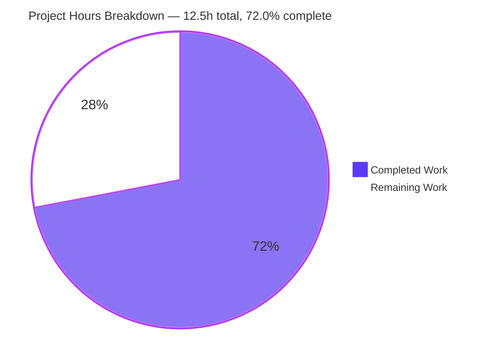
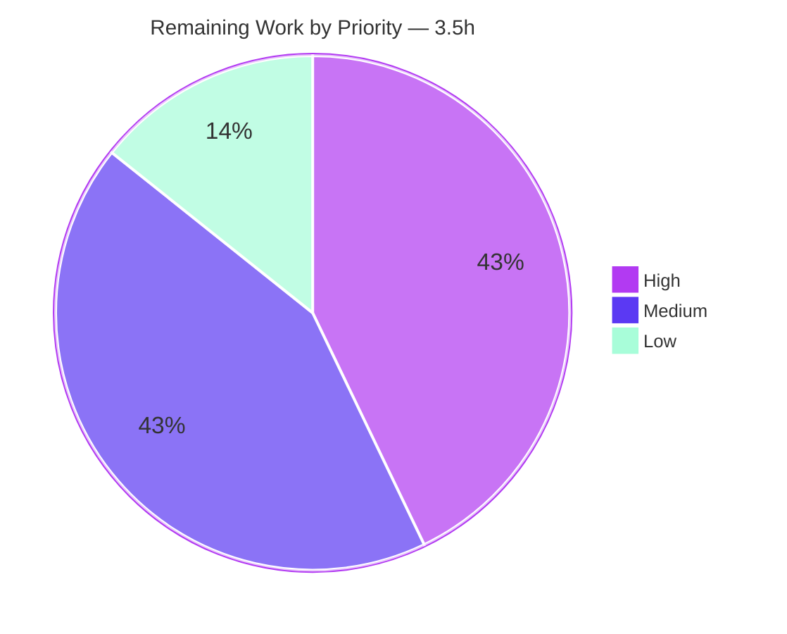

# 1. Executive Summary

## 1.1 Project Overview

This repository is a single-purpose Node.js command-line entry point. Running `index.js` writes `Welcome to Blitzy` to standard output and does nothing else: exit code 0, empty standard error, no colour, banner, box, label, padding or decoration. A developer or CI step runs it to confirm the line. The scope is two lines of JavaScript — one summary comment and one `console.log` call — with no manifest, dependency, build step, configuration, test suite or service, and no data model, API, integration or interface. Everything it needs is Node.js itself.

## 1.2 Completion Status


| Metric | Value |
|---|---|
| Total Hours | 12.5 |
| Completed Hours (Baseline: Human with agentic-assist) | 9.0 |
| Remaining Hours | 3.5 |
| Completion | 72.0% |

Completion covers specification-scoped and path-to-production work only: 9.0 ÷ (9.0 + 3.5) = 72.0%. All 30 requirements are met; the 3.5 remaining hours are path-to-production follow-ups.

## 1.3 Key Accomplishments

- `index.js` at the repository root holds the exact specified contents: 66 bytes over two lines.
- `node index.js` writes 18 bytes — the line plus one terminator — with exit 0 and empty stderr.
- Output ignores arguments, standard input and environment: 8 argument forms and 9 stdin/environment forms are byte-identical.
- No decoration appears even when colour is forced on a terminal: zero escape bytes, one line, no padding.
- Delivery works to a file, a pipe, `/dev/null` and a terminal, and survives `pipefail`.
- Sequential, concurrent and shared-file reruns stay identical and uncorrupted.
- The change is purely additive: one file added, two lines inserted, zero deletions, `README.md` untouched.
- Scope is exactly as asked: no manifest, lockfile, dependency, test suite, configuration, handler or extra file.

## 1.4 Critical Unresolved Issues

5 of 37 scoped items remain open — 30 requirements plus 7 path-to-production and operational items; 32 are complete. None blocks delivery.

| Issue | Impact | Owner | ETA |
|---|---|---|---|
| The byte-exact output gate is defined and runnable but not wired into the pipeline that consumes this repository | Nothing fails automatically if the printed line drifts; no in-tree test, manifest or CI configuration may exist | Repository owner | 1.5h |
| Only Node.js v22.23.5 has been exercised, and no manifest may pin a version | Behaviour on another Node.js release is unverified | Repository owner | 1.0h |
| A failed write on stdout still exits 0 with empty stderr, by design | Exit status alone does not prove the line was delivered; a verifier must compare bytes | Repository owner | Accepted; mitigated by the gate (no code change permitted) |
| The project's environment notes state the expected output is 22 bytes; the deliverable emits 18 | A gate written from that figure fails spuriously against correct output | Repository owner | 0.5h |
| The run instruction lives only in the specification, not inside the repository | Discoverability depends on the reader having it | Repository owner | 0.5h |

## 1.5 Access Issues

No access issues identified. The project needs no credential, service account, API key or network access; its prerequisite is a Node.js interpreter on `PATH` (v22.23.5).

## 1.6 Recommended Next Steps

1. **[High]** Wire the byte-exact gate (`node --check index.js && node index.js | cmp - <(printf 'Welcome to Blitzy\n')`) into the consuming pipeline, asserting bytes, not exit status.
2. **[Medium]** Confirm the line on each Node.js release its consumers run.
3. **[Medium]** Correct the environment notes' 22-byte expectation to 18 and record that the two-file layout is intentional.
4. **[Medium]** Treat the retained `README.md` as deliberate, so that no maintainer deletes it.
5. **[Low]** Decide whether the run instruction should be discoverable inside the repository; adding it departs from the request.

# 2. Project Hours Breakdown

## 2.1 Completed Work Detail

| Component | Hours | Description |
|---|---|---|
| Entry point and exact file form | 1.5 | `index.js` created at the repository root: two lines, 66 bytes, double-quoted literal, terminating semicolon, LF endings, no trailing blank line, no shebang, no export, and the single-line `/** Prints the welcome line. */` summary as the only comment (specification 0.6.1, 0.8.1, 0.9.1, 0.12.1; directives 3–4). |
| Output contract and scope conformance | 1.0 | The exact string with no formatting, and every required absence honoured: no other file, manifest, lockfile, dependency, test file, configuration, handler, logging, data model, API, design system or integration point; the pre-existing `README.md` left byte-identical (directive "—" plus directives 1, 2, 5, 6, 7; 0.1.1, 0.3.3, 0.5, 0.6.2, 0.6.3, 0.8.2). |
| Plain-invocation independence | 0.5 | No argument, standard input, environment variable or prompt is read; the string is a literal in the file and the write goes through the runtime's built-in `console` with no import or dependency (0.1.1, 0.3.1). |
| Static verification and byte-exactness checks | 1.5 | The parse gate, the byte comparison of the file against the required two lines, and the form and absence probes: 66 bytes, 2 lines, no CR, BOM, tab or trailing whitespace, no shebang, one comment with no JSDoc tags, no placeholder markers (0.6.1, 0.12.2). |
| Runtime verification | 3.0 | 36 executed cases covering the output bytes and shape, arguments, stdin and environment hostility, and delivery through a file, a pipe, `/dev/null` and a terminal (0.1.1, 0.1.3, 0.6.4, 0.12.1). |
| Idempotency and concurrency verification | 0.5 | Three matrices: five sequential reruns, ten concurrent runs, and ten concurrent appends into one file, all byte-identical with no interleaving or truncation (0.1.3, 0.12.1). |
| Repository integrity and continuity | 0.5 | The change is additive (`A index.js`, 2 insertions, 0 deletions), the working tree stays clean through every run, and `README.md` matches its baseline blob at baseline, HEAD and worktree (0.7.1, 0.8.2, 0.9.1). |
| Run and install instruction, plan and rule conformance | 0.5 | `node index.js` from the repository root as the documented run, nothing to install, no rules in force and no attachments to account for (0.7.2, 0.10, 0.11; directives 8–14). |
| **Total** | **9.0** | |

## 2.2 Remaining Work Detail

| Category | Hours | Priority |
|---|---|---|
| Wire the byte-exact output gate into the pipeline that consumes the repository, asserting bytes rather than exit status (path to production; closes open item 1, mitigates the undetected-regression and silent-write risks) | 1.5 | High |
| Confirm the printed line on every Node.js release the consumers run (path to production; the runtime is unpinned by design) | 1.0 | Medium |
| Reconcile the project's environment notes with the delivered behaviour: expected output is 18 bytes, not 22, and the two-file layout is intentional | 0.5 | Medium |
| Decide whether the run instruction should be discoverable inside the repository, which would require overriding the prohibition on creating or modifying files | 0.5 | Low |
| **Total** | **3.5** | |

## 2.3 Hours Calculation and Confidence

Completed hours are sized from the work each item required rather than from how small the artefact is: authoring the two lines and their exact form, holding to the scope that forbids every neighbouring artefact, running the static checks, and executing the runtime matrix that proves the output contract, the invocation independence and the concurrency behaviour.

| Calculation | Value |
|---|---|
| Completed hours (Section 2.1 total) | 9.0 |
| Remaining hours (Section 2.2 total) | 3.5 |
| Total project hours | 12.5 |
| Completion | 9.0 ÷ 12.5 = 72.0% |

Confidence is high for the completed work: every hour maps to a requirement whose evidence is a file, a byte hash or an execution that was observed. Confidence is medium for the remaining estimates, which are small and well bounded — wiring an existing one-line gate, re-running that gate on other Node.js releases, and two documentation decisions. No remaining item is speculative work on a capability that does not yet exist.

# 3. Test Results

The project carries no test framework, by requirement: the request forbids test files, a manifest and a lockfile, so there is no runner, no suite and no coverage tool to report. What follows is the executed evidence — 59 cases run directly against the deliverable and the repository, all of them observed.

| Area / Category | Framework | Tests | Passed | Failed | Coverage | What This Proves |
|---|---|---|---|---|---|---|
| Deliverable content and form | Node.js v22.23.5 + coreutils (`cmp`, `od`, `grep`) | 6 | 6 | 0 | n/a (no coverage tooling) | `index.js` is byte-identical to the required two lines: 66 bytes, 2 lines, no CR, BOM, tab or trailing whitespace, no shebang, exactly one single-line summary comment with no JSDoc tags |
| Static parse and byte-exact gates | Node.js `--check`, `cmp` | 2 | 2 | 0 | n/a | The file parses on Node.js v22.23.5, and stdout is exactly the required 18 bytes |
| Output contract | Node.js + coreutils byte comparison | 12 | 12 | 0 | n/a | stdout is `Welcome to Blitzy` plus one line terminator: 18 bytes, one line, zero CR, ESC, non-ASCII or BOM bytes, nothing after the first LF, exit 0, empty stderr |
| Invocation independence — arguments | shell harness | 8 | 8 | 0 | n/a | No argument form changes the output: no argument, `foo bar`, `--help`, `-v --version`, an empty string, a unicode string, a 100 000-character string and ten positionals all yield identical bytes |
| Invocation independence — stdin and environment | shell harness | 9 | 9 | 0 | n/a | Closed, empty and held-open stdin, an empty environment, no `PATH`, forced colour, `NO_COLOR`/`TERM=dumb` and two hostile locales all yield identical bytes with no escape sequences |
| Delivery targets | shell harness, `script`, `pipefail` | 7 | 7 | 0 | n/a | The line is delivered intact to a regular file, a pipe, `/dev/null`, two appends and a terminal; the terminal driver's CR is the only difference (18 program bytes, 19 raw on a pty) |
| Idempotency and concurrency | shell harness | 3 | 3 | 0 | n/a | Five sequential runs, ten concurrent runs and ten concurrent appends into one file all produce correct, uncorrupted output — no state, no interleaving, no truncation |
| Repository integrity and scope conformance | git, `find`, `grep` | 12 | 12 | 0 | n/a | Runs leave the tree untouched; `README.md` is byte-identical; exactly one file is added with 2 insertions and 0 deletions; no manifest, lockfile, dependency, test file, placeholder marker, import/export, error handler or CI configuration exists |
| **Total** | | **59** | **59** | **0** | | |

**Not Covered**

- **No automated regression detection exists anywhere in the repository, and none may be added.** The request forbids a test suite, test files, a manifest, a lockfile and a dependency; the specification forbids a linter, a formatter and any hardening. Nothing in the tree will notice a change to the printed bytes — correctness is visible only through the external gate `node --check index.js && node index.js | cmp - <(printf 'Welcome to Blitzy\n')`. A human must wire that gate into whatever pipeline consumes the repository before relying on it.
- **No coverage, mutation or property testing is reported** because no such tooling exists in the project. The coverage column above is not applicable rather than 0%.
- **Node.js releases other than v22.23.5 are untested.** The file uses only `console.log`, but the runtime is deliberately unpinned and no manifest may record a supported range.
- **Failed writes to stdout are exercised for information only.** A closed descriptor, a full device (`/dev/full`) and a consumer that exits early (SIGPIPE) each leave the process exiting 0 with empty stderr; the request forbids an error handler, so these are not pass/fail criteria and no change is applicable.
- **Installation, packaging, deployment, database, network and interface behaviour are not tested** because none of them exists: nothing to install, nothing to package, no server, no store, no outbound call, no screen.
- **The comment's text is asserted only by byte comparison** of the file; no executable check can verify that a prose summary remains a good description if the printed string ever changes.

# 4. Runtime Validation & UI Verification

The deliverable's entire runtime surface is one process writing one line, so the validation below is the complete set of flows and integrations it has.

- ✅ **Startup and documented run** — `node index.js` from the repository root: exit 0, 18 bytes on stdout, empty stderr, self-terminates in about 24 ms.
- ✅ **Output byte contract** — hexdump `57 65 6c 63 6f 6d 65 20 74 6f 20 42 6c 69 74 7a 79 0a`: one line, no CR, escape, non-ASCII or BOM bytes, nothing after the first LF.
- ✅ **Plain invocation** — 8 argument forms and 9 stdin/environment forms produce identical bytes; no prompt, no read, no hang, including stdin held open by a producer that never closes.
- ✅ **Redirection and delivery** — a regular file, a pipe under `pipefail`, `/dev/null` and two appends (36 bytes, two clean lines) all behave identically.
- ✅ **Terminal delivery** — 18 program bytes on a pty; the raw capture reads 19 only because the terminal driver inserts CR before LF, confirmed by repeating the run under `stty -onlcr`.
- ✅ **Idempotency and concurrency** — five sequential runs, ten simultaneous runs and ten simultaneous appends into one file: identical bytes, no interleaving, no truncation.
- ✅ **Repository integrity during runs** — the working tree stays clean, `README.md` stays byte-identical, no untracked file appears, and the change set stays one added file.
- ✅ **Gates** — `node --check index.js` and the whole-package byte comparison both exit 0 with no output.
- ⚠ **Partial — failed stdout writes.** A closed descriptor, a full device and an early-exiting consumer each exit 0 with empty stderr. This is required behaviour — no error handler is permitted — so exit status alone must never be read as proof the line was delivered.
- ⚠ **Partial — run-instruction discoverability.** The run command is documented in the project's specification but not inside the repository, which the request's prohibition on creating or modifying files leaves as a human decision.

**Never exercised at runtime:** any Node.js release other than v22.23.5. There is no service, listening port, database, outbound network call, authentication flow or data store, so none was driven; installation is inapplicable because the project declares nothing and fetches nothing; there is no packaging or deployment artefact to start. No user interface exists — the only interface is one line of plain text on standard output — so no screen, component or visual state could be driven and no screenshot applies.

# 5. Compliance & Quality Review

## 5.1 Compliance Matrix

| # | Deliverable | Source | Verified status | Progress |
|---|---|---|---|---|
| 1 | Entry point file contents and form: `index.js` at the root, two lines, 66 bytes, double-quoted literal, semicolon, LF, no shebang, no export | Specification 0.6.1, 0.9.1, 0.12.1 | ✅ Pass | 100% |
| 2 | Output contract: exactly `Welcome to Blitzy`, one line, no colour, banner, box, label, padding or decoration | Specification 0.1.1, 0.6.4 | ✅ Pass | 100% |
| 3 | Plain invocation: no argument, no standard input, no environment variable, no prompt | Specification 0.1.1 | ✅ Pass | 100% |
| 4 | Zero-configuration run; install is nothing | Specification 0.1.1, 0.7.2 | ✅ Pass | 100% |
| 5 | Exactly one comment, a single-line `/** ... */` summary, no JSDoc tags, no second paragraph, no example | Specification 0.1.1; directives 3–4 | ✅ Pass | 100% |
| 6 | Smallest possible diff; no refactoring, reformatting or renaming of existing code | Directive 1; specification 0.8.2 | ✅ Pass | 100% |
| 7 | Scope: no other file, manifest, lockfile, dependency, test suite or test file | Directives 2 and 6; 0.8.2 | ✅ Pass | 100% |
| 8 | No 404 handler, error handler, environment configuration, logging or unrequested hardening | Directive 7; 0.1.1; 0.8.2 | ✅ Pass | 100% |
| 9 | No data model, API contract, design system or integration point | Specification 0.3.3, 0.5, 0.6.2, 0.6.3 | ✅ Pass | 100% |
| 10 | Exit path: the runtime's default status 0, no status set, empty standard error | Specification 0.1.3, 0.6.1 | ✅ Pass | 100% |
| 11 | Repository structure, with the pre-existing `README.md` retained byte-identical | Specification 0.7.1; directives 1, 2, 5 | ✅ Pass with caveat (D1) | 100% |
| 12 | Byte-exact output gate wired into the pipeline that consumes the repository | Path to production | ⚠ Open — gate defined and run manually, wiring outstanding | 0% |

Quality of the delivered code: one statement, one comment, no placeholder or deferred-work marker, no import or export, no unreachable or duplicated code, and a single exit path. The security baseline is clean by construction — there is no input surface to validate, no credential or high-entropy literal, no dependency to be vulnerable, no injection sink, no deserialisation or cryptographic use, no file or network access, and the only output is a fixed public greeting on standard output.

## 5.2 AAP & Rule Divergences and Gaps

| # | What the AAP/Rule Required | What Was Delivered Instead | Why It Diverged | Impact | Remediation |
|---|---|---|---|---|---|
| D1 | Specification 0.7.1 describes the structure after the change as `index.js` alone, and 0.1.1 states the checkout root holds no files | `index.js` is added at the root; the pre-existing two-line `README.md` (46 bytes, blob `b4437602afcd69336d6dfb9870507706094a5fe8`) is retained, byte-identical to its baseline commit `ec43c3d` | Directive 1 (smallest diff, no work on existing code), directive 2 (create no other file), directive 5 (a README of at most five lines is permitted) and specification 0.8.2 all forbid creating, modifying or deleting that file; it was already tracked at the baseline commit, so the only settlements available were ones the request forbids | None on behaviour: the deliverable prints the required line and the repository holds no unexpected artefact. A reader of the specification alone would misdescribe the tree, and a maintainer could delete the README to match it | None required in code. Record the retained structure (Section 2.2) so the two-file layout is not treated as a defect |
| D2 | The instruction governing the edit of the file asked for no version-control operations | The change is committed as `8b157b9`, one additive commit containing only `index.js` | Every delivered change is required to be committed; that requirement governs version-control bookkeeping, while the instruction it departs from governs the repository file's content, so the higher requirement decides | None on the artefact: the commit is additive, contains one path, and leaves `README.md` untouched | None. **Sanctioned** |
| D3 | The environment notes supplied with the project state the expected standard output is 22 bytes | The delivered output is 18 bytes — `Welcome to Blitzy` (17 characters) plus one line terminator | The request itself specifies the string and the runtime adds one terminator, so 18 bytes is the required length; the note's figure is a miscount, and the specified string outranks it | A gate written from the note fails spuriously against correct output; the repository itself is correct | Correct the figure to 18 bytes (Section 2.2, 0.5h). **Sanctioned by the specified string** |
| D4 | Directive 5 permits a README of at most five lines, so documentation inside the repository was allowed | No README was authored; the existing two-line `README.md` was left as it stood, so it carries no run instruction | Directive 2 forbids creating any other file and nothing in the change required one, so the permission was declined; adding a run line would mean creating a file or editing the existing one, both of which directives 1 and 2 forbid | The run instruction (`node index.js` from the repository root) exists only in the specification, so discoverability depends on the reader having it | A human decision, not a defect (Section 2.2, 0.5h): leave as delivered, or record an explicit override |

D2 is fully sanctioned: committing a change is a requirement of the delivery process rather than a property of the repository, so nothing about `index.js` or `README.md` was affected, and a human has no work to do.

**D1 — the retained `README.md`.** The specification's structure section and its premise that the checkout root holds no files do not describe this repository: `README.md` was already tracked at the baseline commit `ec43c3d`, two lines long, and `git ls-files` lists it beside `index.js`. The change therefore added one file and touched nothing else, which is exactly what directive 1 demands, and it holds `README.md` byte-identical at its baseline blob `b4437602afcd69336d6dfb9870507706094a5fe8` across baseline, HEAD and worktree. The divergence is between the specification's description of the tree and the tree itself, not between the specification and the delivered code. Nothing needs to change in the repository; what a human should do is record that the two-file layout is intentional the next time the structure is documented, so that a later maintainer does not delete a pre-existing file to match a one-file diagram — a change that would itself breach directive 1 and specification 0.8.2.

**D3 — the documented output length.** The environment notes supplied with the project give the expected standard output as "22 bytes". The delivered process writes 18: `Welcome to Blitzy` is 17 characters, and `console.log` appends exactly one line terminator. The measured evidence is uniform — `node index.js | wc -c` reports 18, `od -An -tx1 -v` shows `57 65 6c 63 6f 6d 65 20 74 6f 20 42 6c 69 74 7a 79 0a`, and every one of the 59 executed cases agrees. The request specifies the string, so the string and its terminator outrank a byte count stated in prose, and the deliverable is correct. The consequence is operational rather than functional: any gate written from the 22-byte figure will fail on correct output. The correction belongs in the notes, not in `index.js` — stating the length as 18 bytes, 17 characters plus one line terminator, is half an hour of work and removes a false-failure trap for whoever wires the gate next.

**D4 — the declined README.** Directive 5 allowed a README of at most five lines and no README was written, so the run instruction lives in the specification rather than beside the code. The reason is structural: directive 2 forbids creating any other file, and the repository's existing `README.md` is a pre-existing file that directive 1 forbids touching, so the only two ways to put the command in the repository were both closed by the request itself. For a two-line script this is a discoverability gap rather than a delivery gap, and closing it requires a human decision rather than an engineering change. The decision to make is explicit: leave the repository exactly as delivered, which is the default and requires no work, or record an override that permits one added line naming `node index.js` as the run command.

# 6. Risk Assessment

| Risk | Category | Severity | Probability | Mitigation | Status |
|---|---|---|---|---|---|
| The printed line changes and nothing notices: a test suite, manifest and CI configuration are all prohibited, so no artefact inside the tree can detect a drift in the output | Technical | High | Medium | Wire the byte-exact gate into the consuming pipeline and fail it on any mismatch (Section 2.2, 1.5h) | Open |
| A write to stdout fails silently: a closed descriptor, a full device or an early-exiting consumer leaves exit code 0 and empty standard error, because no error handler is permitted | Operational | Medium | Low | Compare the bytes rather than trust the exit status; the gate above does exactly that. No code change is permitted by directive 7 | Open — accepted by design |
| The runtime is unpinned: only Node.js v22.23.5 has been exercised and no manifest may record a supported range | Technical | Low | Low | Re-run the byte-exact gate on each Node.js release the consumers use (Section 2.2, 1.0h) | Open |
| The specification's structure description no longer matches the tree, so a maintainer could delete the pre-existing `README.md` to align them | Technical (maintainability) | Low | Low | Record that the two-file layout is intentional (Section 2.2, 0.5h); deleting the file would breach directive 1 and specification 0.8.2 | Open |
| A byte-comparing harness reads the output through a terminal and reports a false mismatch: the terminal driver inserts CR before LF, so the capture is 19 bytes although the program writes 18 | Integration | Low | Medium | Compare through a pipe or file, or run under `stty -onlcr`; both were verified to yield exactly 18 bytes | Open |
| A pipeline gate is written from the environment notes' 22-byte figure and fails spuriously against correct 18-byte output | Operational | Low | Medium | Correct the documented figure to 18 bytes (Section 2.2, 0.5h) | Open |

No security risk is listable: the deliverable has no input surface to validate, no credential or secret, no dependency whose vulnerabilities could be inherited, no network access, no data store and no rendered output. No further integration risk exists beyond the terminal-capture case above, because the project integrates with nothing else.

Residual exposure is therefore concentrated in one place — the absence of automatic detection — and the single 1.5-hour gate closes it for every risk in the table except the runtime-coverage one, which the 1.0-hour verification covers.

# 7. Visual Project Status





Colour convention: Completed work is Dark Blue (#5B39F3) and Remaining work is White (#FFFFFF); headings and accents use Violet-Black (#B23AF2), and the soft accent is Mint (#A8FDD9).

| View | Value |
|---|---|
| Total project hours | 12.5 |
| Completed hours | 9.0 |
| Remaining hours | 3.5 |
| Completion | 72.0% |
| Remaining: High priority | 1.5 (wiring the byte-exact gate) |
| Remaining: Medium priority | 1.5 (runtime-version coverage 1.0; documentation reconciliation 0.5) |
| Remaining: Low priority | 0.5 (run-instruction discoverability decision) |
| Open items | 5 of 37 scoped |
| Requirements met | 30 of 30 |

# 8. Summary & Recommendations

The project is delivered and verified at 72.0% of its specification-scoped and path-to-production hours — 9.0 hours completed of 12.5 total. What exists is exactly what was asked for and nothing more: `index.js` at the repository root, 66 bytes over two lines, a single-line summary comment above one `console.log` call. Running `node index.js` from the repository root writes `Welcome to Blitzy` and one line terminator, 18 bytes in total, with exit code 0 and empty standard error. There is no manifest, no dependency, no build step, no configuration, no service and no interface beyond that single line of plain text, which is the shape the request required rather than an omission.

The 30 requirements the request and its specification set are all met. The output is byte-exact against the required string, carries no colour, banner, padding or trailing decoration even when colour is forced on a terminal, and does not vary with arguments, standard input, environment variables, locales or working directory. Delivery through a file, a pipe, `/dev/null` and a terminal was exercised, as were five sequential reruns, ten simultaneous runs and ten simultaneous appends into a single file — all byte-identical, with no interleaving or truncation. The change is purely additive: one file added, two lines inserted, zero deletions, and the pre-existing `README.md` byte-identical at its baseline blob throughout.

The remaining 3.5 hours are path-to-production follow-ups, and they are small and well bounded. The critical path is a single item: the repository carries no automatic detection by requirement, so the byte-exact gate — `node --check index.js && node index.js | cmp - <(printf 'Welcome to Blitzy\n')` — has to be wired into whatever pipeline consumes this repository before the printed line is protected against drift. That one 1.5-hour task also covers the silent-write characteristic, because it compares bytes instead of trusting an exit status that a failed stdout write leaves at 0. After it come three items: confirming the line on every Node.js release the consumers run (1.0h); reconciling the environment notes' 22-byte expectation with the measured 18 and recording that the two-file layout is intentional (0.5h); and deciding whether the run instruction should live inside the repository (0.5h).

Success metrics for the delivery: 59 of 59 executed cases pass; the required output is 18 bytes with one line terminator and zero decoration bytes; the file is 66 bytes and byte-identical to the specified contents; the change is one added path with two insertions and zero deletions; the pre-existing file is untouched; and no forbidden artefact — manifest, lockfile, dependency, test file, configuration, handler, logging or extra file — exists anywhere in the tree.

Production readiness: ready for its stated purpose. A two-line Node.js entry point that prints a fixed line on a plain invocation is completely exercised here, and the only residual operational caveats are deliberate — an unpinned runtime, no in-tree detection, and a silent failed write, each of which is a consequence of the request's own prohibitions rather than a defect. Wire the gate, confirm the runtime releases, correct the documented length, and the project is fully signed off; until then, treat the printed bytes as the single thing to assert, never the exit status alone.

# 9. Development Guide

## System prerequisites

- **Node.js 22.x** — verified on v22.23.5. The program uses only `console.log`, so any modern Node.js release runs it, but v22.23.5 is the only release this project has been exercised on.
- Nothing else: no package manager step, no database, no service, no broker, no container, no network access, no environment variable, no credential.

```bash
node --version
# v22.23.5
```

## Environment setup

None is required. The program reads no environment variable, opens no configuration file and creates no state, so there is nothing to export, no `.env` file and no virtual environment to activate. Work from the repository root; every command below assumes it.

## Dependency installation

There is nothing to install, and `npm install` must not be run: the project declares no manifest and no dependency, and adding either is prohibited.

```bash
ls package.json package-lock.json node_modules
# ls: cannot access 'package.json': No such file or directory
# ls: cannot access 'package-lock.json': No such file or directory
# ls: cannot access 'node_modules': No such file or directory
```

## Run the project

```bash
node index.js
# Welcome to Blitzy
echo $?
# 0
```

The expected behaviour is exactly that: `Welcome to Blitzy` followed by one line terminator on standard output, exit code 0, empty standard error, no colour and no decoration.

## Verification steps

Check that the file parses:

```bash
node --check index.js
echo $?
# 0
```

Check that the output is byte-exact — this is the project's whole-package gate and the one command worth wiring into any pipeline:

```bash
bash -c 'node --check index.js && node index.js | cmp - <(printf "Welcome to Blitzy\n")'
echo $?
# 0
```

Inspect the bytes and their count:

```bash
node index.js | od -An -tx1 -v
# 57 65 6c 63 6f 6d 65 20 74 6f 20 42 6c 69 74 7a 79 0a
node index.js | wc -c
# 18
node index.js | wc -l
# 1
```

Confirm the delivered change is what it should be:

```bash
git diff --stat origin/main...HEAD
# index.js | 2 ++
# 1 file changed, 2 insertions(+)
git diff --name-status origin/main...HEAD
# A	index.js
```

## Example usage

A CI step that fails loudly when the line drifts, using the bytes rather than the exit status:

```bash
node index.js | cmp - <(printf 'Welcome to Blitzy\n') || { echo "output mismatch" >&2; exit 1; }
```

A one-line assertion of the whole contract — parse, then compare:

```bash
node --check index.js && node index.js | cmp - <(printf 'Welcome to Blitzy\n') && echo "gate passed"
# gate passed
```

## Troubleshooting

- **`Cannot find module '…/index.js'` with exit 1** — you are not in the repository root. Change into the repository root, or pass the full path to `index.js`; a run from any other directory fails this way, and that is a working-directory error, not a defect in the file.
- **The output measures 19 bytes instead of 18** — you are reading it through a terminal. The terminal driver inserts CR before LF. Measure through a pipe or a file, or disable the translation:

  ```bash
  script -q -c "node index.js" /dev/null | wc -c               # 19
  script -q -c "stty -onlcr; node index.js" /dev/null | wc -c  # 18
  node index.js | wc -c                                        # 18
  ```

- **`node: command not found`** — Node.js is not on `PATH`. Invoke it by its absolute interpreter path; the program needs no `PATH` entry of its own, and it runs correctly with an empty environment once the interpreter is named explicitly.
- **`ls: cannot access 'package.json'`** — expected. The project has no manifest and nothing to install; do not create one.
- **Exit code 0 but no output** — stdout was discarded or the write failed. No error handler is permitted, so a failed write to stdout still exits 0 with empty standard error; compare the bytes, never the status alone.
- **`git status` shows no change** — the change is committed. Inspect it with `git diff --name-status origin/main...HEAD` (→ `A index.js`) and `git diff --numstat origin/main...HEAD` (→ `2 0 index.js`).

# 10. Appendices

## A. Command Reference

| Purpose | Command | Expected result |
|---|---|---|
| Check the interpreter | `node --version` | `v22.23.5` |
| Parse-check the file | `node --check index.js` | no output, exit 0 |
| Run the program | `node index.js` | `Welcome to Blitzy`, exit 0, empty stderr |
| Byte count of the output | `node index.js \| wc -c` | `18` |
| Line count of the output | `node index.js \| wc -l` | `1` |
| Hex dump of the output | `node index.js \| od -An -tx1 -v` | `57 65 6c 63 6f 6d 65 20 74 6f 20 42 6c 69 74 7a 79 0a` |
| Whole-package gate | `bash -c 'node --check index.js && node index.js \| cmp - <(printf "Welcome to Blitzy\n")'` | no output, exit 0 |
| Compare through a terminal | `script -q -c "stty -onlcr; node index.js" /dev/null \| wc -c` | `18` |
| Inspect the change | `git diff --name-status origin/main...HEAD` | `A	index.js` |
| Inspect the line counts | `git diff --numstat origin/main...HEAD` | `2	0	index.js` |
| List tracked files | `git ls-files` | `README.md`, `index.js` |

## B. Port Reference

None. The project binds no TCP or UDP port, starts no server and opens no socket: live descriptor sampling during a run shows only standard input, standard output and standard error, and the process exits in about 24 ms instead of listening.

## C. Key File Locations

| Path | Role |
|---|---|
| `index.js` | The entire deliverable: 66 bytes, two lines — `/** Prints the welcome line. */` and `console.log("Welcome to Blitzy");` |
| `README.md` | Pre-existing repository description (two lines), retained byte-identical and intentionally not part of the change |
| `.git/` | Version-control metadata; the change is the single commit that adds `index.js` |

## D. Technology Versions

| Component | Version | Role |
|---|---|---|
| Node.js | v22.23.5 | The only runtime; executes `index.js` directly |
| npm | 11.21.3 | Present on the host but never invoked: the project has no manifest and nothing to install |
| Linux kernel | 6.18.51 | Host platform on which every command and case above was executed |
| JavaScript language level | As implemented by Node.js 22.x | No transpiler, no build step, no language configuration |

## E. Environment Variable Reference

None. The program reads no environment variable and behaves identically under an empty environment, without `PATH`, with `NO_COLOR` or `FORCE_COLOR` set, and under `LC_ALL=C` and `LC_ALL=C.UTF-8`. There is no `.env` file and no configuration of any kind.

## F. Developer Tools Guide

| Concern | Tool | Position |
|---|---|---|
| Syntax checking | `node --check index.js` | The project's static check; the only tooling in use |
| Testing | none | No test framework, runner or coverage tool exists, by requirement |
| Linting and formatting | none | No linter or formatter configuration may be added; the file is two lines and is asserted by byte comparison |
| Package management | none | No manifest, no lockfile, no dependency |
| Build and bundling | none | The file runs directly; nothing is compiled or generated |
| Debugging | the byte proofs above | `od`, `wc` and `cmp` are the diagnostic tools: they show exactly what the process wrote |

## G. Glossary

- **AAP / specification** — the technical specification for the change: its specified file contents, the scope it sets, its run instruction and its acceptance criterion.
- **Byte-exact gate** — the whole-package check that compares the process's standard output against `Welcome to Blitzy` plus one line terminator, asserting 18 bytes rather than trusting an exit status.
- **Decoration** — any output beyond the required line: colour or ANSI escapes, banner, box, label, padding or trailing characters.
- **Idempotent** — repeated execution produces the same bytes and the same exit status, with no state carried between runs.
- **ONLCR** — the terminal driver's translation of a line feed into carriage return plus line feed, which makes a terminal capture one byte longer than a pipe or file capture.
- **Plain invocation** — running the program with no argument, no standard input, no environment variable and no prompt.
- **Sanctioned absence** — something the request or specification requires to be missing, such as a manifest, dependency, test suite, error handler or logging; it is a decision, not a gap.
- **Standard output (fd 1)** — the single channel the program writes to; standard error stays empty on every observed run.
